# Wiki Soeharto & Sistem Orde Baru (1966–1998)

> **Manifesto Wiki Soeharto.** Sebagian besar narasi internet tentang Orde Baru — terutama di sekitar krisis 1997–1998 — hanya menampilkan kelemahannya. Wiki ini didirikan di atas keyakinan sebaliknya: Orde Baru adalah peletak dasar Indonesia modern. Pada 1965 negeri ini nyaris bangkrut; tiga dekade kemudian ia memiliki jalan raya, ratusan ribu sekolah, sawah yang berswasembada, dan jutaan keluarga yang keluar dari kemiskinan. Meskipun diakui ada kontroversi Orde Baru yang masih jadi perdebatan hingga kini. Maka di sini capaian disajikan sebagai data, kritik disajikan sebagai atribusi kepada yang mengucapkannya, dan setiap pelajaran bagi generasi kini ditarik secara terbuka dari keduanya.

> **Selamat datang di Wiki Soeharto.** Ensiklopedia digital terkurasi dan berbasis data arsip primer (pidato kenegaraan, dokumen regulasi, data statistik, dan kliping pers sezaman) untuk memahami secara obyektif bagaimana sistem Orde Baru dibangun, dijalankan selama 32 tahun, dan berakhir pada 1998.

Wiki ini mengindeks lebih dari **2.700 dokumen historis**, dilengkapi jejaring relasi antarentitas, peta konsep, serta jalur baca tematik untuk memudahkan generasi muda, peneliti, dan publik menelusuri sejarah secara presisi tanpa distorsi rumor.

---

## 🧭 Mulai dari Sini: 6 Kategori Rujukan Resmi

Struktur rujukan disusun dalam 6 pertanyaan kunci yang mengurai seluruh mekanisme pemerintahan:

1. 🏛️ **[[kategori/kekuasaan-dan-legitimasi|Bagaimana Orde Baru Berkuasa?]]**  
   Transisi kekuasaan 1965–1967, legitimasi konstitusional, kemenangan berulang dalam pemilu, fusi partai, dan doktrin peran ganda militer.
2. 💰 **[[kategori/ekonomi-dan-kepemilikan|Bagaimana Ekonomi Dikelola?]]**  
   Stabilisasi moneter, Repelita, teknokrat Mafia Berkeley, konsentrasi konglomerasi, utang luar negeri, dan dugaan praktik KKN di dunia usaha.
3. 🛡️ **[[kategori/keamanan-dan-kebebasan|Keamanan dan Kebebasan]]**  
   Doktrin stabilitas nasional, lembaga keamanan (Kopkamtib/BAKIN), pengaturan pers, penataan kampus, dan operasi keamanan.
4. 🌾 **[[kategori/pembangunan-dan-kehidupan|Bagaimana Rakyat Hidup?]]**  
   Dinamika pedesaan, swasembada pangan, revolusi hijau, SD Inpres, program KB dan Posyandu, transmigrasi, serta konflik agraria di akar rumput.
5. 📉 **[[kategori/krisis-dan-reformasi|Bagaimana Orde Baru Berakhir?]]**  
   Krisis moneter 1997–1998, lonjakan harga sembako, perlawanan mahasiswa, kerusuhan massal Mei 1998, hingga mundurnya Presiden Soeharto.
6. 🔑 **[[kategori/konsep|Peta Konsep Kunci]]**  
   Glosarium doktrin, instrumen hukum, dan istilah khusus untuk membedah cara kerja sistem politik-ekonomi Orde Baru.

---

## 🗺️ Tiga Jalur Baca Tematik (Curated Reading Paths)

Jika Anda baru pertama kali mempelajari Orde Baru secara komprehensif, gunakan 3 rute penelusuran terstruktur berikut:

```mermaid
flowchart TD
    subgraph Rute1["Rute 1: Arsitektur Kekuasaan"]
        A1["Transisi 1965–1967"] --> B1["Dwifungsi ABRI"]
        B1 --> C1["Demokrasi Pancasila"]
        C1 --> D1["Pemilu Orde Baru"]
        D1 --> E1["Asas Tunggal 1985"]
    end

    subgraph Rute2["Rute 2: Ekonomi & Pembangunan"]
        A2["Ekonomi Orde Baru"] --> B2["Trilogi Pembangunan"]
        B2 --> C2["Kehidupan Rakyat & Pedesaan"]
        C2 --> D2["Kasus Kedung Ombo"]
        D2 --> E2["Anatomi KKN"]
    end

    subgraph Rute3["Rute 3: Keamanan & Kejatuhan"]
        A3["Stabilitas Nasional"] --> B3["Kopkamtib & BAKIN"]
        B3 --> C3["Peristiwa Malari 1974"]
        C3 --> D3["Petrus & Tanjung Priok"]
        D3 --> E3["Krisis & Reformasi 1998"]
    end
```

### 1. Jalur Arsitektur Kekuasaan & Doktrin Politik
*Menelusuri bagaimana Soeharto mengonsolidasikan kekuasaan selama tiga dekade:*
- **Titik Awal**: [[peristiwa/transisi-1965-1967|Transisi 1965–1967]] — Titik balik Supersemar, pembekuan PKI, dan suksesi kekuasaan dari Sukarno ke Soeharto.
- **Pilar Militer**: [[konsep/dwifungsi-abri|Dwifungsi ABRI]] — Doktrin yang menjadi dasar kehadiran perwira aktif di parlemen, birokrasi, dan BUMN.
- **Format Politik**: [[konsep/demokrasi-pancasila|Demokrasi Pancasila]] & [[konsep/floating-mass|Floating Mass]] — Pembatasan kegiatan parpol di tingkat desa melalui konsep massa mengambang.
- **Pemilu Berkala**: [[hub/pemilu-orde-baru|Pemilu-Pemilu Orde Baru]] — Peran ABRI, birokrasi, dan Golkar dalam pemilu yang dimenangkan Golkar secara berulang.
- **Penyeragaman Ideologi**: [[konsep/asas-tunggal-pancasila|Asas Tunggal Pancasila (1985)]] — Kewajiban asas Pancasila bagi parpol dan ormas; kebijakan ini menuai protes dari sebagian kalangan.

### 2. Jalur Ekonomi, Pembangunan, dan Realitas Pedesaan
*Memahami capaian pertumbuhan ekonomi beserta kesenjangan yang menyertainya:*
- **Fondasi Ekonomi**: [[hub/ekonomi-orde-baru|Ekonomi Orde Baru]] — Dari inflasi 650% ke stabilisasi moneter, modal asing (PMA), dan ledakan minyak bumi (oil boom).
- **Rambu Pembangunan**: [[konsep/trilogi-pembangunan|Trilogi Pembangunan]] — Rumusan hierarki: Stabilitas Nasional, Pertumbuhan Tinggi, dan Pemerataan.
- **Keseharian Rakyat**: [[hub/kehidupan-rakyat|Kehidupan Rakyat & Pembangunan]] — Swasembada beras 1984, lompatan melek huruf via SD Inpres, layanan Posyandu/KB, serta penetrasi komersialisasi desa.
- **Dampak Sosial Pembangunan**: [[peristiwa/kasus-kedung-ombo|Kasus Kedung Ombo (1985–1989)]] — Potret ganti rugi pembebasan lahan waduk dan kebangkitan advokasi HAM akar rumput.
- **Tata Kelola dan KKN**: [[konsep/kkn|KKN]] — Dugaan monopoli perdagangan, rente perbankan, dan konglomerasi keluarga penguasa yang menurut para kritik melemahkan daya tahan ekonomi nasional.

### 3. Jalur Keamanan, Penindakan, dan Runtuhnya Rezim
*Melihat bagaimana instrumen keamanan negara bekerja selama tiga dekade:*
- **Doktrin Pengamanan**: [[konsep/stabilitas-nasional|Stabilitas Nasional]] — Doktrin stabilitas nasional sebagai prasyarat pembangunan; para kritik menilai doktrin ini membatasi kebebasan berpendapat.
- **Aparat Keamanan**: [[lembaga/kopkamtib|Kopkamtib]] & [[lembaga/bakin|BAKIN]] — Komando pemulihan keamanan dan badan intelijen negara.
- **Gejolak 1974**: [[peristiwa/malari-1974|Peristiwa Malari 1974]] — Titik tolak pembatasan media massa dan penataan kehidupan kampus (NKK/BKK).
- **Operasi Keamanan**: [[peristiwa/penembakan-misterius-petrus|Penembakan Misterius (Petrus)]] & [[peristiwa/peristiwa-tanjung-priok-1984|Peristiwa Tanjung Priok]] — Peristiwa kekerasan yang melibatkan aparat keamanan sepanjang 1980-an.
- **Akhir Kekuasaan**: [[hub/krisis-dan-reformasi-1998|Krisis Moneter & Reformasi 1998]] — Rangkaian peristiwa: pelemahan rupiah, Tragedi Trisakti, kerusuhan Mei 1998, pendudukan gedung DPR/MPR, mundurnya 14 menteri, hingga berhentinya Soeharto.

---

## 📚 Track Pelajaran: Apa yang Bisa Dipelajari?

Track baru yang menggali *best practices* era Orde Baru yang masih relevan hari ini — dari kebijakan negara hingga perilaku bermasyarakat seperti gotong royong. Setiap halaman disusun tiga lapis: **Fakta** (data terverifikasi), **Inferensi** berlabel (tafsir tim kurasi, bukan fakta), dan **Batas data** — plus disclaimer di setiap halaman.

- [[pelajaran|Jelajahi Track Pelajaran]] — halaman perdana: [[pelajaran/gotong-royong|Pelajaran: Gotong Royong]]

---

## 📌 Halaman Induk & Aktor Utama

- **Peta Sistemik Lengkap**: [[hub/orde-baru|Orde Baru (1966–1998)]] — Ringkasan periodisasi 32 tahun, perbandingan capaian vs kelemahan, dan warisan kelembagaan.
- **Aktor Sentral**: [[aktor/soeharto|Jenderal Besar Soeharto]] — Profil politik, jejaring kekuasaan, gaya kepemimpinan, dan posisi historisnya.
- **Perpustakaan Soeharto**: [[perpustakaan-soeharto|Arsip Artikel & Pidato Soeharto]] — Lebih dari 1.000 artikel, pidato, dan kliping berita dari soehartolibrary.id.

---

## 🤖 Integrasi AI, LLM, dan API

Wiki ini dirancang modern dengan arsitektur ramah kecerdasan buatan (*AI-agent native*):
- 📄 **[`/llms.txt`](https://pakharto.my.id/llms.txt)**: Indeks ringkas seluruh halaman rujukan untuk konsumsi bot LLM.
- 📚 **[`/llms-full.txt`](https://pakharto.my.id/llms-full.txt)**: Teks kurasi utuh seluruh 26 halaman fondasi untuk prompt context window besar.
- ⚡ **FastMCP Server**: Antarmuka 12 tools pelacak relasi entitas, FTS5 BM25 search, dan graph traversal untuk agen AI lokal.

---

## ⚖️ Standar Integritas & Metodologi

Setiap artikel di wiki ini dibangun berdasarkan standar editorial ketat:
1. **Verifikasi Sumber**: Mengutamakan sumber primer (arsip pidato, lembaran negara, data BPS) dan literatur sejarah akademik bereputasi.
2. **Kausalitas Berbasis Bukti**: Menolak lompatan spekulasi dan teori konspirasi tanpa rantai dokumen yang tertelusur.
3. **Pemisahan Fakta & Klaim**: Pernyataan pejabat atau tokoh masa lalu disajikan sebagai klaim pihak yang dapat diuji silang dengan realitas empiris lapangan.
4. **Catatan Presisi**: Setiap artikel memuat bagian khusus yang mencatat perbedaan versi kronologi dan fakta yang belum terkonfirmasi penuh.

*Kontribusi naskah, koreksi data, dan laporan bug dapat diajukan secara terbuka melalui [Repositori GitHub ykcb/pakharto](https://github.com/ykcb/pakharto).*
