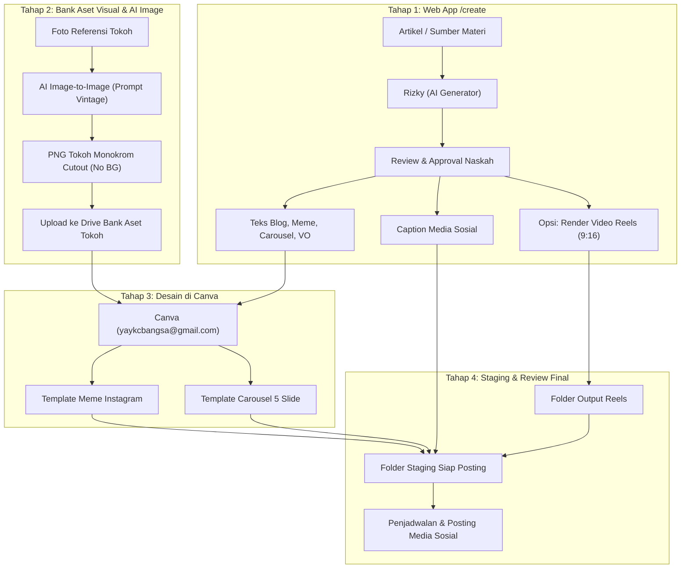

# Panduan Lengkap Design System & Produksi Konten Turunan
**Ekosistem Konten Wiki Pak Harto —  C8 dan YKCB**  
*URL Web App /create:* [https://pakharto.my.id/create](https://pakharto.my.id/create)

---

## 1. Peta Alur Kerja Produksi (*End-to-End Workflow*)

Proses pembuatan konten turunan pakharto.my.id menggabungkan otomatisasi AI teks pada web app `/create`, pembuatan visual berbasis template di Canva, dan kurasi bertahap di Google Drive sebelum penjadwalan publikasi ke media sosial.



---

## 2. Struktur Folder Google Drive Akun YKCB

Semua aset dan hasil kerja diorganisir dalam folder Google Drive berikut:

| Kategori / Folder | Tautan Google Drive | Deskripsi & Fungsi |
| :--- | :--- | :--- |
| **Output Teks Otomatis** | [Buka Folder Teks](https://drive.google.com/drive/folders/1sBOh5xTXjCIIfbO6ooM1RL_A-3Hk06k7) | File `teks.md` hasil kerja Rizky agen Hermes (Blog, VO, Carousel, Meme) dari web app. |
| **Output Caption Sosmed** | [Buka Folder Caption](https://drive.google.com/drive/folders/1ogyvVuAEUvWgx3LOf7kljmz3_KZGQeFu) | File `caption.md` (hook, body, CTA, hashtag untuk Reels, Carousel, Meme). |
| **Output Video Reels** | [Buka Folder Output Reels](https://drive.google.com/drive/folders/1z3SHrD1TQn_9qE4Tngg4harD8vbFaULe?usp=drive_link) | File video MP4 hasil render reels kinetik dari web app `/create`. |
| **Bank Aset Tokoh Monokrom** | [Buka Folder Aset Tokoh](https://drive.google.com/drive/folders/1Vp-jB5vB1Hleie47KG1v79CQjxO6WbC-) | Kumpulan gambar PNG tokoh cut-out vintage tanpa background untuk Canva. |
| **Staging Siap Posting** | [Buka Folder Staging Posting](https://drive.google.com/drive/folders/1vwafqBaA6A0X8PkRg8KbGPHj-1v2kMK-?usp=drive_link) | **Tempat pengumpulan akhir** meme, carousel, reels, dan caption sebelum dijadwalkan ke sosmed. |
| **File Prompt AI Foto Vintage** | [Buka Dokumen Prompt](https://drive.google.com/file/d/1GyDr_NvKtDJfy7tHXu2jecuQRqJgWM3t/view?usp=drive_link) | Dokumen master prompt AI image-to-image untuk pembuatan gambar tokoh. |

---

## 3. Design System Konten Turunan

Design system ini menjaga konsistensi identitas visual dan gaya bahasa di seluruh media turunan YKCB. Untuk C8 bisa copas atau sesuaikan lagi.

### A. Identitas Visual Tokoh: Vintage Halftone Archival Cutout
Karakter visual tokoh mengangkat estetika fotografi jurnalistik dan arsip politik Indonesia pertengahan abad ke-20 (*mid-20th-century political photography*):
* **Format:** PNG RGBA transparan murni (*subject only — transparent background*). Tanpa bingkai, tanpa poster, tanpa elemen grafis tambahan.
* **Palet Warna:** Monokrom kontras tinggi (hitam arang/charcoal, abu-abu hangat, dengan *undertone* sepia halus).
* **Tekstur:** Pola titik *halftone* koran otentik (*newspaper halftone dots*), butiran film analog kasar (*analog film grain*), tekstur sablon usang (*distressed screen-print*), dan tepian tinta kasar (*rough ink edges*).
* **Integritas Subjek:** Proporsi wajah, ekspresi, postur, pakaian, dan atribut khas tokoh dipertahankan 100% tanpa distorsi.

#### Master Prompt AI Image-to-Image (Tokoh Vintage)
Gunakan prompt ini pada platform AI image generator favorit (Midjourney, Nano Banana, Stable Diffusion, Fooocus, dll.) dengan mengunggah foto tokoh sebagai referensi:

```text
Transform the uploaded reference image into a vintage archival editorial subject, using the visual aesthetics of mid-20th-century Indonesian political photography and retro printed media.

CRITICAL INSTRUCTION: SUBJECT ONLY — TRANSPARENT BACKGROUND.

Preserve the original subject faithfully. Do not redesign, reinterpret, replace, or invent elements.

1. Subject preservation
- Preserve the exact identity, facial features, facial proportions, expression, pose, body proportions, clothing, accessories, and distinctive characteristics of the original subject.
- Maintain photographic realism and historical authenticity.

2. Visual style transformation
Apply the following treatment exclusively to the subject:
- Vintage black-and-white archival photography.
- High-contrast monochrome with warm sepia undertones.
- Authentic newspaper halftone dot patterns.
- Coarse analog film grain.
- Distressed screen-print texture.
- Vintage photocopy imperfections.
- Rough ink edges and subtle printing irregularities.
- Aged photographic surface with visible paper-print texture.
- Deep charcoal shadows and textured highlights.
- Authentic mid-century documentary photography appearance.

3. Color treatment
- Predominantly monochrome black, charcoal, warm gray, and subtle sepia. Strong tonal separation.
- No red graphic elements unless naturally present in the original subject.

4. Background removal — ESSENTIAL
- Completely remove the original background.
- Extract the subject cleanly and isolate it against a fully transparent background.
- PNG RGBA format with transparent pixels outside the subject.
- No background color, no poster layout, no decorative elements, no checkerboard rendered into image.

STRICT RULE: Transform the subject only. Do not create a poster. Do not generate a new scene.
```

> [!TIP]
> Setelah gambar tokoh selesai digenerate, unduh format PNG transparannya lalu unggah ke [Folder Drive Bank Aset Tokoh](https://drive.google.com/drive/folders/1Vp-jB5vB1Hleie47KG1v79CQjxO6WbC-) agar tim Canva dapat langsung menggunakannya.

---

### B. Warna & Tipografi Brand
* **Warna Utama:**
  * Navy YKCB: `#01192f` (digunakan pada blok teks meme dan elemen penegas)
  * Charcoal / Black: `#1f1f1f`
  * Warm Off-White / Cream: `#f6f5f2` (latar background slide carousel)
  * White: `#ffffff` (teks di atas background gelap)
* **Tipografi:**
  * Judul / Punchline / Cover: Bold Sans-serif (DejaVu Sans Bold / Montserrat / Inter Bold)
  * Body Text: Clean Regular Sans-serif dengan *line-height* longgar (1.25x s.d. 1.4x)
* **Logo:** Logo resmi YKCB terpasang di sudut kiri bawah pada format meme dan slide cover.

---

### C. Persona & Gaya Penulisan Editorial (Persona Astha Citra)
* **Karakter Penulis (Asta Citra):** Mahasiswa ilmu politik tingkat akhir, cerdas, santai, kritis tanpa sinis, dan komunikatif seperti mengobrol di kafe.
* **Prinsip Utama:**
  1. **Anti-Halusinasi:** Tidak boleh menambah angka, nama, atau klaim yang tidak ada di sumber.
  2. **Terjemahkan Jargon:** Jelaskan istilah rumit dengan bahasa sehari-hari tanpa menghilangkan substansi masalahnya.
  3. **Pisahkan Fakta & Klaim:** Berikan atribusi yang tegas (*"Pihak X mengklaim..."*).

---

## 4. Format Konten & Panduan Pembuatan di Canva

### A. Artikel Blog (Web App `/create`)
* **Format:** Teks artikel hingga 5.000 karakter (tanpa spasi).
* **Alur:** Langsung masuk ke masalah utama $\rightarrow$ konteks $\rightarrow$ simplifikasi persoalan $\rightarrow$ konsekuensi bagi pembaca.

---

### B. Meme Instagram (Lanjutan di Canva)
1. **Draf Teks dari `/create`:** 1–2 baris punchline tajam (maksimal 15 kata).
2. **Proses di Canva:**
   * Buka Canva dan login menggunakan Google akun: **`yaykcbangsa@gmail.com`**.
   * Buka **Template Meme Instagram**.
   * Tempel teks punchline dari `/create` ke dalam area blok teks Navy `#01192f`.
   * Ganti atau masukkan gambar tokoh monokrom vintage dari [Folder Bank Aset Tokoh](https://drive.google.com/drive/folders/1Vp-jB5vB1Hleie47KG1v79CQjxO6WbC-).
   * Sesuaikan proporsi font dan tata letak agar teks tidak menutupi logo YKCB.
   * Export dalam format PNG (1200×1200 piksel).

---

### C. Carousel Instagram 5 Slide (Lanjutan di Canva)
1. **Draf Teks dari `/create`:** Terdiri dari tepat 5 slide:
   * **[Slide 1 - Cover]:** 1 kalimat pendek yang memancing penasaran (6–18 kata).
   * **[Slide 2 s.d. 5 - Isi]:** 1 gagasan utama per slide (25–80 kata/slide).
2. **Proses di Canva:**
   * Login ke Canva dengan akun **`yaykcbangsa@gmail.com`**.
   * Buka **Template Carousel Instagram**.
   * Salin teks Slide 1 s.d. Slide 5 ke masing-masing halaman template.
   * Sisipkan gambar tokoh monokrom pada slide cover dan slide pendukung.
   * Sesuaikan ukuran font teks agar tetap proporsional dan nyaman dibaca di layar ponsel.
   * Export 5 slide ke format PNG berurutan.

---

### D. Narasi VO & Video Reels Vertikal (9:16)
1. **Draf Naskah VO:** Naskah monolog 60–90 detik (150–220 kata).
2. **Render Video Reels di Web App `/create`:**
   * Setelah naskah disetujui, masuk ke kotak **Video Reels**.
   * (Opsional) Unggah gambar background kustom dengan **aspek rasio wajib 9:16** (contoh: 1080×1920 piksel).
   * Klik **Render Video Reels**. Web app akan menghasilkan video MP4 dengan audio Gemini TTS (suara Leda) dan subtitle kinetik yang tersinkronisasi.
   * Video otomatis terunggah ke [Folder Output Reels](https://drive.google.com/drive/folders/1z3SHrD1TQn_9qE4Tngg4harD8vbFaULe?usp=drive_link).

---

## 5. Prosedur Peninjauan & Penjadwalan Posting (*Staging Protocol*)

Sebelum konten dipublikasikan ke media sosial (Instagram, TikTok, dll.):

1. **Kumpulkan Seluruh Aset Final:**
   * Unduh/ambil file visual Meme dan Carousel dari Canva.
   * Ambil file video Reels MP4 dari folder output Reels atau unduhan web app.
   * Buka file `caption.md` dari [Folder Output Caption](https://drive.google.com/drive/folders/1ogyvVuAEUvWgx3LOf7kljmz3_KZGQeFu).
2. **Unggah ke Folder Staging:**
   * Pindahkan atau unggah semua materi yang sudah siap tersebut ke:  
     👉 **[Folder Staging Siap Posting YKCB](https://drive.google.com/drive/folders/1vwafqBaA6A0X8PkRg8KbGPHj-1v2kMK-?usp=drive_link)**
3. **Pemeriksaan Tim (*Quality Check*):**
   * Pastikan teks visual di gambar/video cocok dengan caption pasangannya.
   * Periksa kesesuaian hashtag dan kelengkapan audio.
4. **Penjadwalan:**
   * Konten yang sudah berada di folder staging siap dimasukkan ke alat penjadwal media sosial (Meta Business Suite / TikTok Scheduler).

---

## 6. Referensi Teknis Pengelola Server (`aws3`)

Bagi tim teknis pengelola infrastruktur:
* **Path Script Backend:** `/home/ubuntu/create-server`
* **Layanan Systemd:** `create-server.service` (user service)
  ```bash
  systemctl --user status create-server
  systemctl --user restart create-server
  ```
* **Koneksi Google Drive (rclone):**
  - File config: `~/.config/rclone/rclone.conf` (remote: `gdrive`)
  - Status koneksi: `python3 /home/ubuntu/create-server/gdrive.py status`
